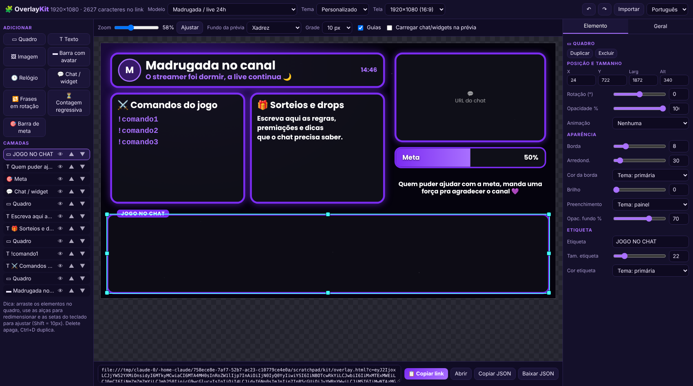
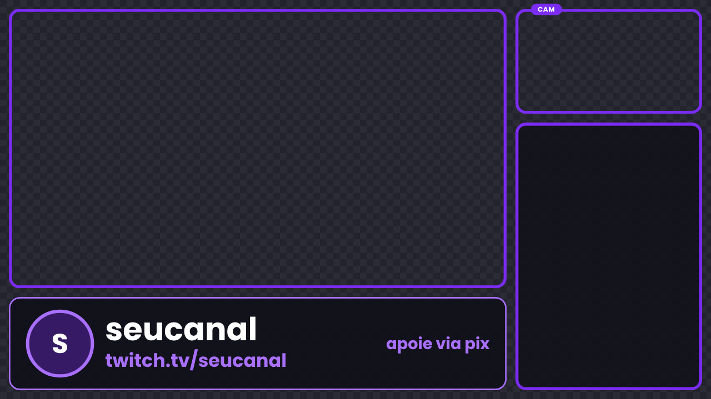
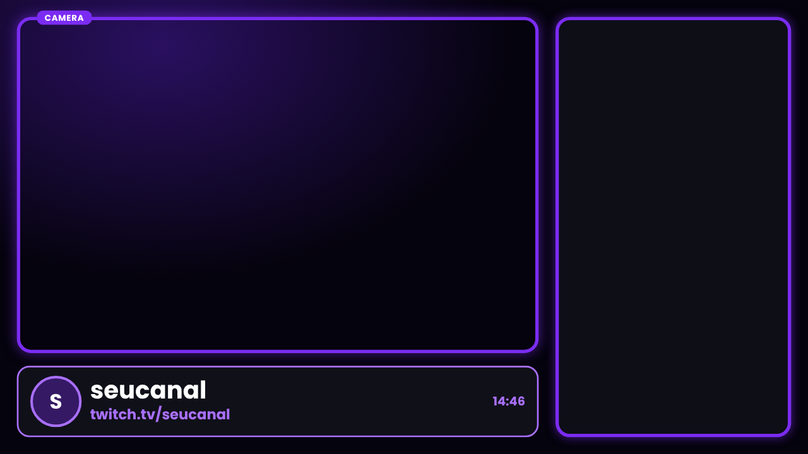
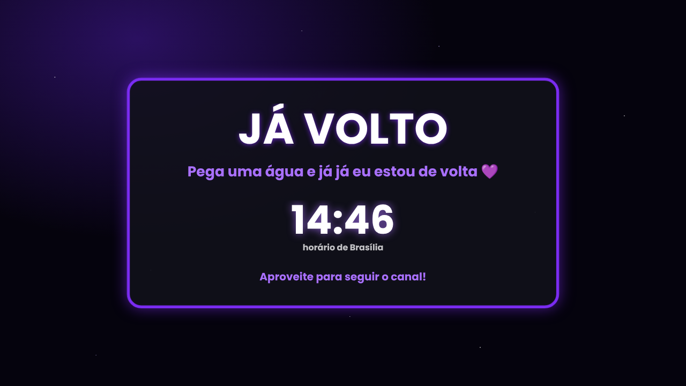
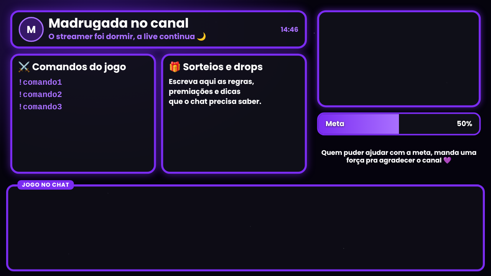

# 🧩 OverlayKit

Monte o **overlay da sua live** sem programar: quadros, textos, relógio, barra de meta, chat e muito mais, tudo arrastando e soltando. No final você copia **um link** e cola numa fonte de *Navegador* do OBS.

> *English summary below.* · [🇬🇧 Jump to English](#-english)



## Para que serve

- Criar telas de **jogo + câmera + chat**, **só conversando**, **já volto/AFK**, **madrugada/24h** ou qualquer layout seu.
- Mudar **posição, tamanho, cores, bordas, brilho, transparência e animações** de cada elemento.
- Usar em **qualquer tamanho de tela** (1080p, 720p, 1440p, vertical 9:16, quadrado).
- Não precisa instalar nada, não precisa de conta e **não envia dados para ninguém**. É só HTML + JavaScript.

| Jogo + câmera + chat | Só conversando |
|---|---|
|  |  |
| **Já volto / AFK** | **Madrugada / live 24h** |
|  |  |

### Todas as cenas prontas / All ready-made scenes

**Horizontal (1920×1080):** Começando (com contagem regressiva) · Jogo + câmera + chat · Jogo + câmera + meta/QR · Jogo + chat (sem câmera) · Só jogo · Só conversando · Já volto/AFK · Madrugada/24h · Encerrando (com contagem) · Widget de meta · PNGtuber (Jogo, Jogo + chat, Conversando, Jogo + faixa de overlay) · Em branco.
**Vertical (1080×1920):** Começando · Conversando · Jogo · Já volto · Encerrando.

*EN:* Starting (countdown), Game+cam+chat, Game+cam+goal/QR, Game+chat, Game only, Just chatting, BRB, Overnight/24h, Ending (countdown), Goal widget, PNGtuber ×4, Blank, plus 5 vertical scenes. New element: **Countdown** (minutes or until HH:MM, custom end text).


## Como usar (3 passos)

1. **Abra o editor.** Duas formas:
   - **Online (recomendado):** ative o GitHub Pages deste repositório (*Settings → Pages → Deploy from a branch → `main` / `(root)`*) e abra `https://SEU-USUARIO.github.io/NOME-DO-REPO/`.
   - **No computador:** baixe a pasta e dê dois cliques em `editor.html`.
2. **Monte o overlay.** Escolha um *Modelo*, troque o *Tema* (cores), arraste e redimensione os elementos, edite textos e cores no painel da direita.
3. **Copie o link** (botão **📋 Copiar link**) e, no OBS, adicione **Fontes → Navegador**:
   - cole o link na **URL** (se estiver usando o editor do computador, o link começa com `file:///` e funciona do mesmo jeito);
   - use **Largura × Altura** iguais ao tamanho da tela mostrado no editor (ex.: 1920 × 1080);
   - deixe o fundo transparente, que já é o padrão do overlay.

Para guardar um layout, use **Baixar JSON** e, depois, **Importar** (aceita o arquivo ou um link). Para enviar a um amigo, basta mandar o **link**: ele já leva toda a configuração.

## Elementos disponíveis

| Elemento | O que faz |
|---|---|
| **Quadro** | Retângulo com borda, brilho, preenchimento, cantos arredondados e etiqueta. Perfeito como moldura da câmera ou do jogo (deixe o preenchimento em "Nenhum" para ficar vazado). |
| **Texto** | Qualquer texto, com fonte, tamanho, peso, cor, alinhamento, sombra e atalhos `{hora}`, `{data}` e `{dia}` que se atualizam sozinhos. |
| **Imagem** | Logo, avatar ou arte (por URL), com moldura e cantos arredondados. |
| **Barra com avatar** | Faixa com foto, título, subtítulo e texto à direita (nome do canal, redes, "apoie via pix"…). |
| **Relógio** | Hora em tempo real, com fuso horário e segundos opcionais. |
| **Chat / widget** | Mostra uma página dentro do overlay: o chat da Twitch, alertas, metas… O editor já tem botões para preencher a URL do **chat popout da Twitch** e do [TeuzinBetterChat](https://www.teuzin.com.br/TeuzinBetterChat/). |
| **Frases em rotação** | Lista de mensagens que se alternam (avisos, comandos, dicas). |
| **Barra de meta** | Barra de progresso com legenda, valores, prefixo (R$…) e porcentagem. |

Cada elemento ainda tem **rotação, opacidade e animação** (brilho pulsando, flutuando, respirando, entrada suave) e pode ser **ocultado** sem apagar.

## Atalhos do editor

| Ação | Como |
|---|---|
| Mover | Arrastar o elemento (ele "gruda" nas bordas e no centro da tela) |
| Redimensionar | Alças nas bordas da seleção |
| Ajuste fino | Setas (1 px) · `Shift` + setas (10 px) |
| Duplicar / Apagar | `Ctrl+D` / `Delete` |
| Desfazer / Refazer | `Ctrl+Z` / `Ctrl+Y` |
| Ordem das camadas | Painel **Camadas** (▲ ▼) |

## Dicas

- O editor salva o seu trabalho no navegador automaticamente.
- Os links ficam longos porque levam a configuração inteira; o OBS aceita sem problema. Se preferir um link curto, hospede o JSON (ex.: neste repositório) e use `overlay.html?src=https://.../meu-overlay.json`.
- Para **testar no navegador**, abra o link e acrescente `&preview=1` (fundo quadriculado).
- Fontes (Poppins, Montserrat, Orbitron…) são carregadas do Google Fonts; sem internet o OBS usa uma fonte parecida do sistema.
- Em **Chat / widget**, alguns sites não permitem aparecer dentro de outra página. O chat popout da Twitch e o TeuzinBetterChat funcionam.
- Guarde em sigilo links de alertas/overlays que contenham sua **chave pessoal** antes de publicar um JSON.

## Estrutura

```
editor.html    editor visual (abra este)
overlay.html   página que o OBS carrega (recebe ?c=<configuração>)
overlay.js     renderizador compartilhado
presets.js     modelos e temas prontos
docs/          imagens
```

Para criar seu próprio modelo, adicione um objeto em `presets.js` (use **Copiar JSON** no editor para obter a configuração).

## Licença

[MIT](LICENSE): use, modifique e compartilhe à vontade. Se gostar, deixe uma ⭐.

---

## 🇬🇧 English

**OverlayKit** lets you build a stream overlay visually (frames, text, clock, goal bar, chat embeds, rotating phrases, avatar lower-thirds) and gives you a **single link** to paste into an OBS *Browser source*. No install, no account, no data leaves your computer.

1. Open `editor.html` (or host the repo with GitHub Pages and open it online).
2. Pick a template and theme, drag/resize elements, tweak colors, borders, glow, opacity, animations, fonts and canvas size (16:9, 9:16, 1:1 or custom).
3. Click **Copy link** and use it as the URL of an OBS Browser source, with width × height equal to the canvas size shown in the editor.

Use **Download JSON / Import** to save layouts, or just share the link: it contains the whole configuration. `preview=1` in the link adds a checkerboard background for testing in a browser. The editor UI has a Portuguese/English switch.

Licensed under MIT.
